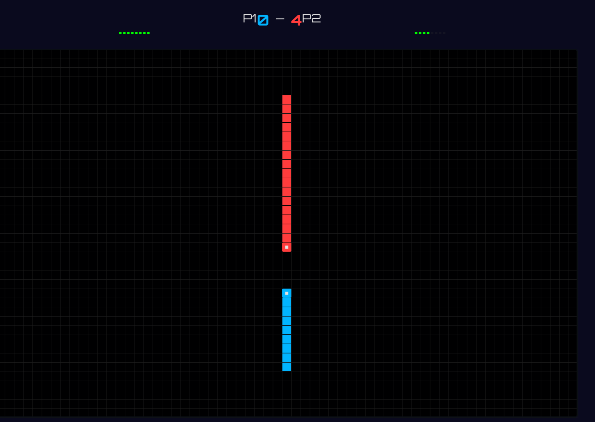

# Tron

An implementation of the Tron Light cycles game with Reinforcement Learning using pygame.

The game is mainly designed for PvE just like the [original](https://pexy.io/game/tron/).
The RL agent is trained using vanilla Q-learning and LFA (Linear Function Approximation).
Its performance isn't AlphaZero-worthy but it occasionally manages to beat me.

>[!NOTE]
> This is a Work in Progress



## Getting started

The main game only relies on Pygame and Numpy libraries and a python 3.14 interpreter.

If you have those you should be fine.

```
pip install pygame-ce==2.5.8 numpy==2.5.3
```

To play the game just run:

```
  python3 main.py
```

or just `python main.py` for some.

## Development/Training

If for some reason you need the full suite, there's devenv.lock file
for nix-users and requirements.lock file for others.

```
pip install -r requirements.lock
```

To simplify interaction with the training script, there's a train.sh file.
<br/>
It can be used to launch many trainings in parallel but I haven't found the
need to do that yet since I think any substantial improvements will come from
either improving the model features or improving the reward function.

## Controls

 | Keys       | Action                                   |
 |------------|------------------------------------------|
 |WASD        | move up, move left, move down, move right|
 | SPACE      | activate boost                           |
 | Keys arrows| same as WASD                             |
 | Enter      | Start game                               |

## Next

As of now, the Reinforcement Learning agent isn't fully ready yet. The goal is
to have it defeat a tier 4 bot. The current Agent currently perform at roughly Tier 1,
with the tier list being (the higher the tier, the better the strategy):

* Random (tier 0)
* Naive (tier 1)
* Blocker (tier 2)
* Min Voronoi (tier 3)
* ?? (tier 4)

---

## Credits

* Music: <https://pixabay.com/music/upbeat-cyberpunk-music-277931/>
* image: <https://i.pinimg.com/736x/af/27/4b/af274b98b88b5c3c38e85a3e3d990830.jpg>
